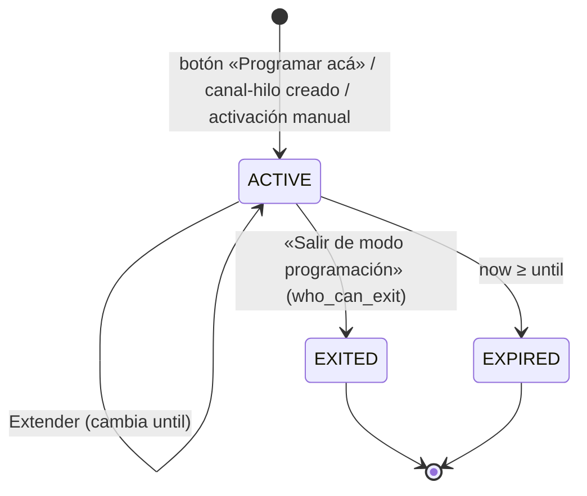

# 01 · Pase a modo programación (diseño)

Estado: borrador para Julian · 2026-10-20 · Base: `universal-bot/docs/code-mode/00-relevamiento.md`, `codemode-base/SKILL.md`.

## 1. Objetivo
- Por defecto el Universal-bot sigue igual: los pedidos de uso interno del servidor los resuelve el CLI básico.
- Si el router clasifica un pedido como **T2/T3** con confianza ≥ `proposal_threshold`, el bot no arranca solo. Le **propone una sola vez** al usuario pasar a modo programación con botones: **Crear un canal para el proyecto / Crear un hilo de proyecto en el canal de proyectos / Programar acá mismo por un tiempo** (selector 1 h · 4 h · hasta que salga) **/ No, resolvelo como siempre**.
- Cuando el usuario acepta, el trabajo se muda a un **canal propio** dentro de la categoría «Proyectos» (un hilo por etapa), a un **hilo** de proyecto en `#proyectos`, o se queda **en el mismo canal/hilo** como sesión de modo programación.
- **Modo programación pegajoso (Julian, 2026-10-20):** el modo se activa **por ubicación** (canal, hilo de Discord o chat donde se conversa), no por pedido. Mientras hay una `CodeModeSession` ACTIVE en ese lugar, el router **no reclasifica** ni vuelve a preguntar: todo lo que llega ahí se atiende en modo programación hasta que alguien autorizado toca **«Salir de modo programación»** o vence el tiempo elegido. Pensado para canales donde se programa la mayor parte del tiempo.
  1. **Activación manual:** quien tenga permiso (`roles.can_activate`) puede escribir una frase tipo «pasemos a modo código» (`manual_trigger_phrases`), usar `/modo-codigo [duración]` o un botón, sin esperar al detector.
  2. **Umbral alto:** como el modo se activa una vez y queda, el detector solo propone con confianza alta (`proposal_threshold`, default 0.8). Si el usuario elige «No, resolvelo como siempre», no se vuelve a proponer para ese pedido.
  3. **Charla dentro del modo:** los mensajes no técnicos o T0 triviales («gracias», «¿qué hora es?») los responde el CLI básico **sin salir del modo**; el resto va al CLI de código.
  4. **Salida o expiración:** el job en curso hace checkpoint y queda en pausa en un punto seguro (nunca a mitad de commit); se puede reanudar reactivando el modo.
- Al usuario se le habla en lenguaje simple. Los detalles técnicos (gate, recetas, diffs, evidencia) van a los hilos de etapa.
- Las preguntas que surgen en medio del trabajo llegan como botones al hilo de la etapa. El estado queda persistido en SQLite (`store.py`) y la espera **no consume** `timeout_long_s`.
- **Regla de aprobación (Julian, 2026-10-20):** «aprobar» ya **no** es aprobar el plan ni la implementación.
  1. Todo el desarrollo y la prueba interna (diseño, lab, implementación local, tests, servidor de desarrollo) avanza **sin aprobación humana obligatoria**.
  2. Condición: corre en un **sandbox** (contenedor/venv/worktree sin credenciales de producción, red de salida restringida, sin acceso a servicios o servidores reales) y pasa un **gate automático de seguridad** (`SANDBOX_CHECK`) antes de ejecutar pruebas. Si el chequeo falla o el trabajo no se puede encapsular, recién ahí se consulta con botones.
  3. La **única aprobación obligatoria** es el **pase a producción**: deploy, merge a la rama productiva, cambios en el entorno real, acciones irreversibles en Discord o servidores. La da quien pidió o un rol dev según config; en T3, un dev.
  4. Las consultas puntuales a mitad del trabajo (ask-bridge) siguen permitidas, pero no son un gate por defecto.
  Es coherente con el canon orquestador-sx: el freno humano (§8.7) queda solo para lo irreversible/producción.
- **Regla de plan probado (Julian, 2026-10-20):** el plan no puede ser solo una idea. Antes de armarlo, `lab-runner` (y `maverick` cuando corresponde, canon §8.2–8.3) hacen **pruebas reales en el sandbox aislado** (`.lab/YYYY-MM-DD-<slug>/` y `.lab/YYYY-MM-DD-mav-<slug>/`), y el plan se entrega con esa evidencia adjunta («ya se probó, esto funciona»: comandos, salidas, tests, PoC).
  1. **Autorización permanente del Lab:** dentro del sandbox, `lab-runner` y `maverick` (modo LAB) avanzan sin pedir permiso para experimentar. El único freno es el gate automático `SANDBOX_CHECK`; producción sigue siendo la única aprobación obligatoria.
  2. **Factibilidad («¿se puede implementar X?»):** Lab prueba → evidencia → plan estructurado basado en lo probado. No se responde ni se planifica sin prueba, salvo que `SANDBOX_CHECK` impida probar: entonces el ítem se marca **«sin probar»** con motivo y se consulta.
  3. **Contrato:** cada paso del plan referencia su `LabEvidence` o se marca explícitamente «sin probar» con motivo (§5). El validador rechaza un plan sin evidencia.
  4. **Maverick:** CONSULT post-lab (contrasta la idea previa con la evidencia) antes de publicar el plan; LAB propio si hay anomalía de entorno en T2+. Propone, no decide.

## 2. Flujo

```mermaid
sequenceDiagram
  actor U as Usuario
  participant L as Listener
  participant R as Router (gate T0–T3)
  participant P as proposer
  participant V as project-provisioner
  participant S as stage-router
  participant A as ask-bridge
  participant O as Orquestador (padre)
  participant M as session-manager
  U->>L: pedido
  L->>M: active_session(location)
  alt hay CodeModeSession ACTIVE (canal/hilo/chat)
    M-->>L: modo programación (sin reclasificar ni proponer)
    L->>R: is_trivial(msg)
    alt charla / T0 trivial
      R-->>L: CLI básico (la sesión sigue ACTIVE)
    else resto
      L->>O: start/continue(Project de la sesión)
    end
  else frase manual / comando /modo-codigo (con permiso)
    L->>M: activate(location, actor, duration)
    M->>U: mensaje pineado [Salir de modo programación]
  else sin sesión
  L->>R: classify(msg)
  alt T0/T1, no-código o confianza < proposal_threshold
    R-->>L: CLI básico (flujo actual)
  else T2/T3 con confianza alta
    R->>P: propose(req, tier) — una sola vez
    P->>U: "¿Pasamos a modo programación?" [Crear un canal para el proyecto][Crear un hilo en #proyectos][Programar acá mismo por ⏱ 1 h / 4 h / hasta que salga][No, resolvelo como siempre]
    U->>P: elige
    alt No, resolvelo como siempre
      P-->>L: CLI básico (marca override_tier, no re-propone)
    else Programar acá mismo
      P->>M: activate(location, actor, duration)
      M->>U: mensaje pineado [Salir de modo programación] + expira a las HH:MM
      P->>O: start(Project ligado a la sesión)
    else Canal | hilo de proyecto
      P->>V: provision(mode, actor)
      alt rol permite
        V->>U: crea canal+hilos o hilo
      else rol no permite
        V->>U: "Se lo propongo a un admin"
        V->>A: ask(admin, "¿Crear proyecto X?")
      end
      V->>O: start(Project)
      O->>O: security_check(sandbox) → SANDBOX_CHECK
      alt check PASS
        O->>O: lab-runner (+ maverick LAB si env-anomaly) → LAB_RUNNING, sin clicks
        O->>S: post(02-lab, LabEvidence: hipótesis, comandos, salidas, veredicto)
        O->>O: maverick CONSULT post-lab
        O->>S: post(03-plan, Plan con evidence_refs) → validador → PLAN_READY
      else FAIL o no encapsulable
        O->>A: ask(stage, "No puedo probar X: ¿cómo sigo?") → WAITING_HUMAN
        O->>S: post(03-plan, ítems marcados "sin probar" + motivo)
      end
      loop por etapa
        O->>S: post(stage, payload técnico)
        S->>U: resumen simple en el hilo raíz/canal
        opt antes de ejecutar pruebas/servidor dev
          O->>O: security_check(sandbox) → SANDBOX_CHECK
          alt falla o no encapsulable
            O->>A: ask(stage, "¿Cómo sigo?") → WAITING_HUMAN
          end
        end
        opt consulta puntual (advisor, duda) — no es gate
          O->>A: ask(stage, question) → estado WAITING_HUMAN
          A->>U: botones en el hilo de la etapa
          U->>A: respuesta
          A->>O: resume(project_id, answer)
        end
      end
      opt hay pase a producción
        O->>A: ask(prod_approval) → PENDING_PROD_APPROVAL
        A->>U: [Aprobar pase a prod][Rechazar] (requester/dev; dev en T3)
        U->>A: respuesta
        A->>O: resume(project_id, answer)
      end
      O->>S: cierre (06) + resumen al usuario
    end
  end
  end
```

### 2.1 Sesión pegajosa: salida y expiración

```mermaid
sequenceDiagram
  actor U as Usuario
  participant M as session-manager
  participant O as Orquestador
  M->>U: aviso `warn_before` antes de expirar [Extender][Salir ahora]
  alt toca «Salir de modo programación» (autorizado) o vence
    M->>O: request_checkpoint(project_id)
    O->>O: termina el paso atómico en curso (commit/test) → checkpoint (resume_token)
    O-->>M: PAUSED
    M->>U: "Salimos de modo programación. El trabajo quedó guardado en <paso>; reactivá para seguir."
    M->>M: estado EXITED | EXPIRED, despinea el mensaje
  else no autorizado
    M-->>U: efímero "no podés salir de este modo"
  end
```

Al crear un canal o hilo de proyecto (opciones a/b), esa ubicación nueva queda con su propia `CodeModeSession` ACTIVE sin vencimiento (`until=None`) hasta cerrar el proyecto o tocar Salir; la ubicación de origen no cambia de modo.

## 3. Estructura en Discord

Para un **proyecto con canal**: categoría `Proyectos` → canal `#p-<slug>` (por ejemplo `#p-reservas-api`). En el canal el bot fija un mensaje con el resumen simple: qué se pide, en qué estado está y el próximo paso. Cada etapa tiene su hilo:

| Hilo | Qué se postea |
|---|---|
| `00-brief` | Pedido original, gate (tier, WorkType, señales, causa conocida, estimación), aceptación. Botón de confirmación del brief. |
| `01-discovery` | Hallazgos de explore/scout con `file:line` y fuentes, y riesgos. |
| `02-lab` | **Va antes del plan.** Hipótesis, comandos ejecutados, salidas, tests, PoC y veredicto (`APPROVE`/`REVISE`/`REJECT`/`YIELD`) de cada `LabEvidence`. Labs ≤2 (≤3 en T3, canon §6.1) + bloque Maverick CONSULT post-lab. Siempre en T2/T3; no pide clicks. |
| `03-plan` | Plan por workstream y allow-list de paths; cada paso enlaza su evidencia de `02-lab` o dice «sin probar: <motivo>». **Informativo**: el trabajo sigue sin esperar. Botones opcionales **Pedir cambios / Frenar** (no bloquean). |
| `04-impl-<ws>` | Uno por workstream: receta, PR, avance y anomalías. |
| `05-verificacion` | Resultado del gate de seguridad del sandbox, evidencia TDD (rojo→verde), checks, VLH si es user-facing, PASS/FAIL. |
| `05b-produccion` | Solo si hay pase a producción: qué se despliega/mergea, riesgos y botones **Aprobar pase a producción / Rechazar**. Es la única aprobación obligatoria. |
| `06-cierre` | Harvest: qué se entregó, PRs, lecciones y deuda. Botón para cerrar o archivar. |

Para un **proyecto chico (hilo)**: en el canal `#proyectos` se abre el hilo `p-<slug>`. Las etapas no tienen hilo propio: van como mensajes con prefijo `[02-lab]`, `[03-plan]` y los botones aparecen en ese mismo hilo.

Orden de etapas: `00-brief → 01-discovery → 02-lab → 03-plan → 04-impl-* → 05-verificacion → 05b-produccion → 06-cierre`. (Antes el lab era `03` y opcional; se renumeró porque ahora es previo y obligatorio al plan.)

Oleadas O2/O3: se reusan los hilos `04`/`05` y el encabezado dice `O2 · correctiva`. Nunca se abren canales nuevos.

## 4. Máquina de estados (Project)

```mermaid
stateDiagram-v2
  [*] --> PROPOSED
  PROPOSED --> DECLINED: No, resolvelo como siempre
  PROPOSED --> PENDING_ADMIN: rol sin permiso
  PENDING_ADMIN --> PROVISIONING: admin aprueba
  PENDING_ADMIN --> DECLINED: admin rechaza / expira
  PROPOSED --> PROVISIONING: Sí
  PROVISIONING --> SANDBOX_CHECK: antes del lab
  SANDBOX_CHECK --> LAB_RUNNING: check PASS (sin clicks)
  LAB_RUNNING --> SANDBOX_CHECK: nuevo experimento con otro entorno/comandos
  LAB_RUNNING --> PLAN_READY: LabEvidence concluyente + validador OK
  LAB_RUNNING --> LAB_RUNNING: hipótesis refutada → replanteo (dentro del budget)
  LAB_RUNNING --> WAITING_HUMAN: no concluyente tras budget / excede tiempo
  PLAN_READY --> RUNNING: plan publicado (sin aprobación)
  RUNNING --> SANDBOX_CHECK: antes de tests / servidor dev
  SANDBOX_CHECK --> RUNNING: check PASS (sin aprobación humana)
  SANDBOX_CHECK --> WAITING_HUMAN: check FAIL o no encapsulable (ítems "sin probar")
  RUNNING --> WAITING_HUMAN: ask() puntual (no gate)
  WAITING_HUMAN --> RUNNING: respuesta
  WAITING_HUMAN --> PAUSED: sin respuesta tras recordatorio
  PAUSED --> RUNNING: /reanudar o botón
  RUNNING --> ESCALATED: falla T3/O3
  ESCALATED --> RUNNING: humano decide seguir
  RUNNING --> DONE: verifier PASS + cierre (sin pase a prod)
  RUNNING --> PENDING_PROD_APPROVAL: verifier PASS + requiere producción
  PENDING_PROD_APPROVAL --> DEPLOYING: aprobado (requester/dev; dev en T3)
  PENDING_PROD_APPROVAL --> RUNNING: rechazado → correctiva
  PENDING_PROD_APPROVAL --> PAUSED: sin respuesta tras recordatorio
  DEPLOYING --> DONE: deploy OK + cierre
  DEPLOYING --> ESCALATED: deploy falla
  RUNNING --> CANCELLED: Frenar
  PAUSED --> CANCELLED: expira pausa
  DONE --> ARCHIVED
  DECLINED --> [*]
```



No hay estado de «plan aprobado»: `PLAN_READY` significa «plan validado con evidencia», no «aprobado». No se llega a `PLAN_READY` sin pasar por `LAB_RUNNING`, salvo ítems marcados «sin probar» tras un `SANDBOX_CHECK` fallido y su consulta. El plan se publica y la ejecución sigue. `SANDBOX_CHECK` es automático y solo cae en `WAITING_HUMAN` si falla. Nada sale del sandbox sin pasar por `PENDING_PROD_APPROVAL`.

### 4.1 Máquina de estados (CodeModeSession)



Al pasar a EXITED/EXPIRED, el `Project` ligado que esté en RUNNING/LAB_RUNNING va a `PAUSED` vía checkpoint (§2.1); los que esperan (`WAITING_HUMAN`, `PENDING_PROD_APPROVAL`) conservan su pregunta abierta. Reactivar el modo en la misma ubicación crea una sesión nueva y ofrece reanudar.

## 5. Contrato de datos (agrega a `contracts.py` y tablas en `store.py`)

```python
class ProjectMode(str, Enum): CHANNEL="channel"; THREAD="thread"
class ProjectState(str, Enum): PROPOSED, PENDING_ADMIN, PROVISIONING, SANDBOX_CHECK, LAB_RUNNING, PLAN_READY, RUNNING, WAITING_HUMAN, PENDING_PROD_APPROVAL, DEPLOYING, PAUSED, ESCALATED, DONE, CANCELLED, DECLINED, ARCHIVED

@dataclass(frozen=True)
class Project:
    id: str                 # "P-<ulid>"
    guild_id: int; requester_id: int; origin_message_id: int
    slug: str; title_plain: str      # título para humanos
    tier: Literal["T2","T3"]; work_type: str
    mode: ProjectMode; state: ProjectState
    channel_id: int | None; root_thread_id: int | None
    run_id: str; wave: Literal["O1","O2","O3"]
    sandbox_id: str | None            # contenedor/venv/worktree asignado
    last_security_check: "SecurityCheckResult | None"
    requires_production: bool         # lo marca el plan; si es False termina en DONE sin gate
    created_at: datetime; updated_at: datetime

@dataclass(frozen=True)
class CodeModeSession:
    id: str                          # "CMS-<ulid>"
    guild_id: int; channel_id: int; thread_id: int | None   # ubicación; thread None = canal entero (o chat directo)
    activated_by: int
    activation: Literal["proposal_here","project_channel","project_thread","manual_phrase","command","button"]
    since: datetime
    until: datetime | None           # None = hasta que alguien salga
    warn_at: datetime | None         # until - warn_before
    project_id: str | None           # proyecto asociado (opcional)
    pinned_message_id: int | None    # mensaje fijo con el botón «Salir de modo programación»
    status: Literal["ACTIVE","EXPIRED","EXITED"]
    ended_by: int | None; ended_at: datetime | None
    # Persistida en SQLite (`code_mode_sessions`); un ACTIVE único por (guild, channel, thread).
    # Al arrancar: re-registra la vista persistente del pin, recalcula warn/expiración con el reloj
    # y expira las vencidas durante la caída (checkpoint → PAUSED del proyecto ligado).

@dataclass(frozen=True)
class Stage:
    project_id: str; key: str        # "00-brief", "01-discovery", "02-lab", "03-plan", "04-impl-api" … "06-cierre"
    thread_id: int | None            # None en modo THREAD (usa root)
    status: Literal["pending","active","waiting","done","skipped"]
    summary_plain: str               # lo que ve el usuario
    last_job_id: str | None

@dataclass(frozen=True)
class PendingQuestion:
    id: str; project_id: str; stage_key: str
    kind: Literal["code_mode_proposal","prod_approval","sandbox_check_failed","lab_inconclusive","advisor_card","human_brake","admin_provision","brief_confirm"]
    blocking: bool                   # True solo para prod_approval, sandbox_check_failed y admin_provision
    prompt_plain: str; detail_ref: str | None   # link al mensaje técnico
    options: list[str]               # custom_id estables "pq:<id>:<opt>"
    allowed_approvers: list[int]     # user/role ids resueltos por config
    message_id: int | None
    asked_at: datetime; remind_at: datetime; pause_at: datetime
    answer: str | None; answered_by: int | None; answered_at: datetime | None
    resume_token: str                # checkpoint del orquestador (fase, oleada, sobre)

@dataclass(frozen=True)
class SecurityCheckResult:
    project_id: str; sandbox_id: str; checked_at: datetime
    passed: bool
    encapsulable: bool               # False → no se puede aislar → consulta
    violations: list[Literal["prod_secret","external_host","write_outside_workspace","destructive_cmd","real_service_access"]]
    detail_ref: str | None           # link al reporte técnico en 05-verificacion

@dataclass(frozen=True)
class LabEvidence:
    id: str                          # "LE-<ulid>"
    project_id: str; lab_path: str   # ".lab/YYYY-MM-DD-<slug>/" o ".lab/YYYY-MM-DD-mav-<slug>/"
    role: Literal["lab-runner","maverick"]
    hypothesis: str                  # qué se quiso probar (núcleo/diferencial, no el producto entero)
    commands: list[str]              # exactamente lo que se corrió en el sandbox
    result: str                      # salidas relevantes (stdout/stderr, pytest) o ref a log
    artifacts: list[str]             # PoC, logs, tests, capturas (paths dentro de .lab/)
    verdict: Literal["APPROVE","REVISE","REJECT","YIELD","INCONCLUSIVE"]
    evidence_class: Literal["running","paper"]   # canon: paper no cuenta como probado
    security_check_ref: str          # SecurityCheckResult que habilitó la corrida
    started_at: datetime; finished_at: datetime; timed_out: bool

@dataclass(frozen=True)
class PlanStep:
    id: str; workstream: str; summary: str; paths: list[str]
    evidence_refs: list[str]         # ids de LabEvidence con verdict APPROVE y evidence_class running
    untested_reason: str | None      # obligatorio si evidence_refs está vacío ("sin probar: <motivo>")

@dataclass(frozen=True)
class Plan:
    project_id: str; wave: Literal["O1","O2","O3"]
    steps: list[PlanStep]
    lab_evidence: list[LabEvidence]  # adjunta; se publica en 02-lab
    maverick_consult: str | None     # bloque CONSULT post-lab (propone, no decide)
    requires_production: bool
    # validate_plan(): rechaza si algún step no tiene evidence_refs válidos ni untested_reason,
    # si un ref apunta a evidencia paper/REJECT/INCONCLUSIVE, o si un step "sin probar" no tiene PendingQuestion.

@dataclass(frozen=True)
class ProductionAction:
    project_id: str
    kind: Literal["deploy","merge_prod_branch","env_change","discord_irreversible","server_irreversible"]
    target: str; summary_plain: str
    approved_by: int | None; approved_at: datetime | None
```

Persistencia: las vistas de botones son `persistent views` (custom_id estable), así sobreviven reinicios. Cuando hay un `ask()` el job **termina** con `JobStatus.WAITING_HUMAN` y libera el lease y el slot de `max_concurrent_jobs`. Con la respuesta se encola un job nuevo con `resume_token`. Por eso la espera no corre el timeout.

## 6. Configuración por servidor (`instances/<guild>.yaml`)

```yaml
code_mode:
  enabled: true
  propose_tiers: [T2, T3]          # T0/T1 siempre CLI básico
  default_mode: ask                # ask | thread | channel | here
  sticky: true                     # el modo queda por ubicación; no se reclasifica cada pedido
  default_duration: 4h             # para «Programar acá mismo»: 1h | 4h | until_exit
  duration_options: [1h, 4h, until_exit]
  warn_before: 10m                 # aviso con [Extender][Salir ahora]
  proposal_threshold: 0.8          # confianza mínima del router para proponer (se propone una vez)
  who_can_exit: [activator, "@dev", "@admin"]   # activator | requester | roles
  manual_trigger_phrases: ["pasemos a modo código", "modo programación", "activá modo código"]
  manual_trigger_command: "/modo-codigo"
  trivial_to_basic_cli: true       # charla/T0 trivial dentro del modo → CLI básico sin salir
  on_exit_running_job: checkpoint_pause   # nunca kill a mitad de commit
  allow_channels: true             # false = solo hilos
  projects_category: "Proyectos"   # se crea si falta (requiere permiso)
  projects_channel: "proyectos"    # para modo hilo
  channel_prefix: "p-"
  max_open_projects: 10            # tope de canales activos
  archive_after_days: 14
  roles:
    can_start_project: ["@dev", "@admin"]   # crear canal/hilo directo
    can_start_thread:  ["@everyone"]
    can_activate:      ["@dev", "@admin"]   # activación manual y «Programar acá mismo»
    can_ask_questions: ["requester", "@dev"] # quién responde consultas puntuales (no gate)
    can_brake:         ["requester", "@admin"]
    admin_review_channel: "admin-bot"       # dónde se proponen cambios
  approvals:
    production: requester|dev      # requester | dev | requester|dev
    production_t3: dev             # en T3 siempre un dev
    dev_roles: ["@dev"]
    plan: none                     # el plan NO se aprueba; se publica
    plan_requires_evidence: true   # el validador rechaza pasos sin LabEvidence o sin "sin probar" + motivo
  lab:
    auto_approve: true             # autorización permanente dentro del sandbox (sujeta a SANDBOX_CHECK)
    max_labs: { T2: 2, T3: 3 }     # budget canon §6.1
    max_replans: 1                 # un replanteo por hipótesis refutada; después consulta
    timeout_per_lab: 20m
    timeout_total: 60m
    resources: { cpu: 2, memory: 2g, disk: 5g, processes: 128 }
    network: sandbox.egress_allowlist   # misma allow-list; nada de servicios reales
    maverick_post_lab: true        # CONSULT post-lab antes de publicar el plan
  sandbox:
    policy: strict                 # strict | off (off = todo pide consulta)
    runtime: worktree+venv         # container | venv | worktree (+combinaciones)
    egress_allowlist: ["pypi.org", "files.pythonhosted.org", "github.com"]
    prod_secrets: deny             # sin credenciales de producción en el entorno
    writes: workspace_only
  security_check: on               # on | off; off solo en dev local, nunca en servidores compartidos
  reminders: { first_after: 4h, pause_after: 24h, cancel_paused_after: 7d }
  language: { user: "es-AR-simple", stages: "es-AR-tecnico" }
```

Al instalar, el bot genera esta propuesta según la estructura que encuentra en el servidor y la manda como `admin_provision` al canal de admin. No aplica nada sin el accept.
> Nota (Frontera): en el servidor de Frontera cualquier cambio al pack de FE-BOT requiere el accept de `#admin-febot`. Se deja como nota, no como tarea.

## 7. Permisos del bot en Discord
- Siempre: `View Channel`, `Send Messages`, `Send Messages in Threads`, `Create Public Threads`, `Read Message History`, `Embed Links`, `Manage Threads` (archivar y renombrar los propios).
- Si `allow_channels`: `Manage Channels` (crear `#p-*` en la categoría; a nivel categoría y no de guild, si se puede).
- Opcional: `Create Private Threads` (proyectos sensibles) y `Manage Messages` (fijar el resumen).
- Al arrancar, el bot chequea los permisos efectivos. Si falta alguno degrada a modo hilo y avisa al admin.

## 8. Casos borde
- **Usuario que no responde:** a las `first_after` hay un recordatorio con mención en el hilo; a las `pause_after` el proyecto pasa a PAUSED (aviso simple + botón Reanudar); a los `cancel_paused_after` pasa a CANCELLED y se archiva.
- **Sesión en canal y en hilo hijo:** gana la más específica (el hilo). Si el canal tiene sesión ACTIVE, los hilos hijos la heredan salvo que tengan la suya; salir en el hilo no apaga la del canal y viceversa (cada pin sale de su ubicación). No se permiten dos ACTIVE en la misma ubicación: activar de nuevo extiende la existente.
- **Mensaje no técnico dentro del modo:** charla o T0 trivial va al CLI básico y la sesión sigue ACTIVE; todo lo demás (incluido T1) va al CLI de código sin preguntar.
- **Salir o expirar con job en curso:** checkpoint en el próximo punto seguro (fin de commit, test o comando), job → PAUSED con `resume_token`; nunca se mata a mitad de commit. Si el paso no termina en `checkpoint_grace` (5 min), se aborta el paso en el sandbox y se descarta el commit a medias del worktree; producción nunca queda a medias porque pasa por `PENDING_PROD_APPROVAL`.
- **Salir sin permiso:** respuesta efímera; la sesión no cambia.
- **Mensaje pineado borrado o desfijado:** el session-manager lo republica; el comando `/salir-modo-codigo` siempre funciona.
- **Pedido mal clasificado:** con «No, resolvelo como siempre» va al CLI básico con `override_tier`. Queda logueado para calibrar el router. Si un T0/T1 escala a T2 en medio del trabajo, se propone de nuevo (una sola vez).
- **Límite de canales:** si `max_open_projects` está lleno, o la categoría tiene 50 canales, se ofrece modo hilo o archivar el más viejo inactivo (botón para el admin). Nunca se borra nada.
- **Sin permiso de rol:** PENDING_ADMIN y se le pregunta al admin. Al requester se le dice «se lo pasé a un admin».
- **Botón de alguien no autorizado:** respuesta efímera «no podés aprobar esto». No cambia el estado. En `prod_approval` de T3 solo cuenta un `dev_roles`; el requester sin rol dev recibe ese mensaje.
- **Gate de seguridad falla:** `SANDBOX_CHECK` → `WAITING_HUMAN` con `sandbox_check_failed` y la lista de violaciones; opciones «Ajustar y reintentar / Seguir sin ejecutar pruebas / Frenar». Nunca se ejecuta igual.
- **Trabajo no encapsulable** (necesita un servicio real, un secreto de prod o un host fuera de la allow-list): se consulta antes de ejecutar; no se intenta «a medias».
- **Acción irreversible detectada en medio del trabajo** (deploy, merge a la rama productiva, borrar en Discord): se corta y pasa a `PENDING_PROD_APPROVAL`, aunque no esté en el plan.
- **Lab no concluyente** (`INCONCLUSIVE`/`YIELD` o evidencia solo `paper`): se reintenta con otra hipótesis dentro de `max_labs`; si se agota, `lab_inconclusive` (no bloquea el resto) y el paso queda «sin probar: no concluyente». Nunca se presenta como probado.
- **Lab que excede tiempo o recursos:** se corta el proceso, `timed_out=True`, se guardan las salidas parciales como artefacto y cuenta como no concluyente. No se sube el límite sin consulta.
- **Hipótesis refutada** (`REJECT`): se replantea el enfoque (con Maverick CONSULT) y se corre un lab nuevo hasta `max_replans`; el plan muestra la hipótesis descartada y por qué. Si no hay alternativa, se le avisa al usuario en simple: «así como se pidió no funciona; estas son las opciones».
- **No se puede probar** (SANDBOX_CHECK falla o no encapsulable): ítem «sin probar» + motivo y consulta; el resto del plan sigue con su evidencia.
- **Plan con cambios pedidos después de arrancar:** «Pedir cambios» en `03-plan` no bloquea; se incorpora como correctiva (O2) en el hilo 04.
- **Proyecto sin pase a producción:** termina en DONE sin aprobación humana; el cierre aclara que quedó solo en el sandbox.
- **Doble click o respuesta duplicada:** primero gana; `answer` es idempotente por `pq.id`.
- **Hilo o canal borrado a mano:** el stage-router lo recrea o hace fallback al hilo raíz y avisa.
- **Reinicio del bot:** `recover_abandoned_jobs` y re-registro de las vistas persistentes con las `PendingQuestion` abiertas.
- **Varias preguntas a la vez:** una sola pregunta abierta por stage; las demás se encolan.

## 9. Servicios y TDD
Son servicios chicos y puros, con Discord detrás de un puerto (`DiscordPort` fake en los tests) y reloj inyectable. Todos se hacen rojo→verde→refactor.

| Servicio | Responsabilidad | Tests primero (ejemplos) |
|---|---|---|
| `session-manager` | `CodeModeSession`: activar, resolver por ubicación, salir, expirar, avisar | **sesión pegajosa no re-pregunta** (2º pedido T2 en la ubicación → `proposer` nunca se llama); **salir restaura** (tras EXITED el próximo T2 vuelve a pasar por el router/proposer); **expiración** con reloj fake (aviso en `warn_at`, EXPIRED en `until`, job → PAUSED vía checkpoint, no a mitad de commit); **reinicio conserva sesión** (store real en tmp, nueva instancia → sigue ACTIVE y re-registra el pin; la vencida durante la caída queda EXPIRED); frase manual con permiso activa y sin permiso no; `who_can_exit` rechaza a terceros; hilo hijo hereda/override del canal; T0 trivial dentro del modo → CLI básico con sesión ACTIVE |
| `proposer` | tier + confianza + config → propuesta y botones según el rol | T1 no propone; T2 con confianza < `proposal_threshold` no propone; T2 propone 4 opciones (canal / hilo / acá por tiempo con selector / como siempre); «acá» crea sesión con `default_duration`; propone una sola vez por pedido; `allow_channels:false` oculta «crear proyecto»; «No» → CLI con override |
| `project-provisioner` | crear canal/hilos o pedir al admin | rol sin permiso → PENDING_ADMIN y no se llama `create_channel`; tope lleno → ofrece hilo; falta `Manage Channels` → degrada; slug único |
| `stage-router` | etapa → destino + render simple/técnico | `02-lab` antes que `03-plan`; `03-plan` en canal → hilo 03; modo hilo → prefijo; O2 reusa 04/05; el resumen simple no lleva jerga (lista negra: diff, PR, stack…) |
| `ask-bridge` | PendingQuestion ↔ botones ↔ resume | ask libera el job; answer encola resume con token; no autorizado se rechaza; recordatorio/pausa con reloj fake; idempotencia; sobrevive reinicio (store real en tmp); consulta puntual tiene `blocking=False`; no existe `plan_approval` |
| `security-gate` | sandbox + comandos/entorno → `SecurityCheckResult` | env con secreto de prod → FAIL `prod_secret`; host fuera de `egress_allowlist` → FAIL `external_host`; escritura fuera del workspace → FAIL; `rm -rf /`, `git push --force`, `DROP` → FAIL `destructive_cmd`; acceso a servicio real → FAIL; todo limpio → PASS y sigue a RUNNING sin `ask()`; FAIL → `WAITING_HUMAN` y no se ejecutan tests; no encapsulable → consulta; `security_check: off` en servidor compartido → error de config |
| `lab-runner` | hipótesis + sandbox → `LabEvidence` | con SANDBOX_CHECK PASS corre **sin ningún `ask()`** (lab corre sin clicks); registra comandos/salidas/artefactos; timeout → `timed_out=True` + INCONCLUSIVE; excede `max_labs` → `lab_inconclusive`; REJECT dispara replanteo hasta `max_replans`; check FAIL → no ejecuta y marca «sin probar» |
| `plan-validator` | `Plan` → OK / rechazo | plan sin `LabEvidence` es **rechazado**; step sin refs ni `untested_reason` → rechazo; ref a evidencia `paper`, `REJECT` o `INCONCLUSIVE` → rechazo; «sin probar» sin PendingQuestion → rechazo; no se llega a `PLAN_READY` sin `LAB_RUNNING` previo; plan válido → publicado sin aprobación |
| `prod-gate` | acción productiva → `PENDING_PROD_APPROVAL` → ejecución | deploy/merge prod/env change sin aprobación no se ejecuta; `production: requester` acepta al requester; `requester|dev` acepta a ambos; T3 rechaza al requester sin rol dev; rechazo vuelve a RUNNING (correctiva); `requires_production=False` → DONE sin gate; acción irreversible no planificada se intercepta |

Integración: tres tests end-to-end con `FakeDiscord` + SQLite en tmp: (0) pedido T2 → «Programar acá mismo · 1 h» → 3 pedidos más sin propuesta → expira → próximo T2 vuelve a proponer; (1) pedido T2 → «Crear un hilo de proyecto» → SANDBOX_CHECK PASS → LAB_RUNNING → PLAN_READY con LabEvidence → plan publicado → DONE **sin ningún click de aprobación**; (2) T3 con deploy → SANDBOX_CHECK PASS → LAB_RUNNING (+ Maverick CONSULT) → PLAN_READY → PENDING_PROD_APPROVAL → aprueba un dev → DEPLOYING → DONE. (3) factibilidad «¿se puede X?» → lab REJECT → replanteo → lab APPROVE → plan con la hipótesis descartada documentada; ninguna respuesta sale antes de la evidencia. El verifier exige la salida de pytest como evidencia (`references/tdd-evidence.md`).

## 10. Decisiones abiertas (para Julian)
1. Default de modo: (a) preguntar siempre, (b) T2→hilo y T3→canal sugerido, (c) por config. Nuevo: `default_duration` de «acá mismo» (a) 1 h, (b) 4 h (propuesto), (c) hasta que salga; y si el detector es solo para `@dev` o para todos.
2. ~~Quién aprueba el plan~~ — **resuelta (Julian, 2026-10-20):** el plan no se aprueba. Solo se aprueba el pase a producción: quien pidió o rol dev según `approvals.production`; en T3, un dev. Queda abierto: runtime del sandbox por defecto (a) worktree+venv, (b) contenedor, (c) por servidor.
3. Tiempos de recordatorio/pausa: (a) 4h/24h/7d, (b) 1h/8h/3d, (c) por servidor sin default.
4. Hilos de etapa: (a) creados todos al inicio, (b) lazy al entrar en la etapa (recomendado).
5. Visibilidad: (a) canales públicos, (b) privados con requester + devs, (c) por proyecto.
6. Al cerrar: (a) archivar el canal, (b) moverlo a la categoría «Proyectos-archivo», (c) dejarlo.
7. Plan probado vs `YIELD_PLAN` del canon: el canon pide Build humano tras `YIELD_PLAN`; acá se reemplaza por publicación automática del plan validado. ¿Se documenta como override local del canon? (recomendado: sí).
8. Grok CLI no tiene runtime en el orquestador: (a) excluirlo del modo código, (b) escribir el runtime antes.
